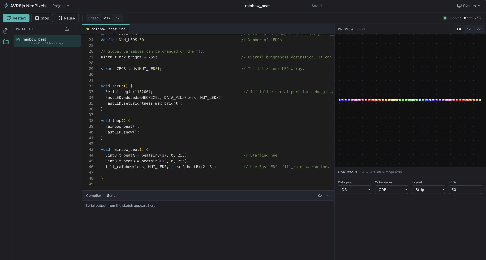

# AVR8js NeoPixels + FastLED Demo

This project demonstrates the use of [avr8js](https://github.com/wokwi/avr8js) library to simulate NeoPixels (ws2812 LEDs) with the [FastLED](https://github.com/FastLED/FastLED) library. You can paste your own Arduino sketch into the editor, and see how it would run on a real AVR microcontroller.

You can find a lot of demo code in the [FastLED-Demos](https://github.com/atuline/FastLED-Demos/tree/master) repository.  
Ready-made sketches can be found in the [demo sketches](./demo_sketches) folder; they are also offered as templates when you create a project. Projects (several files each: `.ino`, `.h`, `.hpp`, `.c`, `.cpp`) are stored by the server in `DATA_DIR` (default `./data`: a SQLite database plus the sketch files) and can be imported and exported as `.ino` or `.zip`.

## Getting Started

To run this project, you need to have [Node.js](https://nodejs.org/) and [Yarn](https://yarnpkg.com/) installed on your system.

First, install the project dependencies by running:

```sh
yarn install
```

Sketches are compiled by a local server that wraps [arduino-cli](https://arduino.github.io/arduino-cli/). Install the pinned toolchain once (the server refuses to start if the versions differ, see `packages/server/config.ts`):

```sh
brew install arduino-cli   # or see the arduino-cli install docs
arduino-cli core update-index
arduino-cli core install arduino:avr@1.8.8
arduino-cli lib install FastLED@3.6.0
```

Then start the compile server and the web app in two terminals:

```sh
yarn server   # http://127.0.0.1:3001
yarn start
```

Alternatively, build the `Dockerfile`, which contains the same toolchain.

The server is configured through environment variables (see `packages/server/config.ts`):

| Variable | Default | Meaning |
| --- | --- | --- |
| `MAX_SKETCH_FILES` | `64` | Files in one project |
| `MAX_SKETCH_BYTES` | `1048576` (1 MiB) | Total size of a project's files, in UTF-8 bytes |
| `BUILD_TIMEOUT_MS` | `60000` | Time limit of one build |
| `MAX_CONCURRENT_BUILDS` | `2` | Builds that run at once |
| `MAX_QUEUED_BUILDS` | `8` | Builds waiting in the queue, more get HTTP 503 |
| `CACHE_ENTRIES` | `200` | Cached build results |
| `DATA_DIR` | `./data` | Projects database and sketch files |
| `ARDUINO_CLI` | `arduino-cli` | Path to the CLI |

The request body limit follows from `MAX_SKETCH_BYTES` and `MAX_SKETCH_FILES`. Behind nginx, `client_max_body_size` in `deploy/nginx.conf` (16 MB) must stay above it.

It will run a local development server, and you can access the project at [http://localhost:3000/](http://localhost:3000/) (the default port is 3000 unless otherwise configured).

### Docker deployment

`compose.yaml` runs the whole app: `server` (the `Dockerfile`, compile server with the pinned toolchain) and `web` (`Dockerfile.web`, the built frontend served by nginx, which proxies `/api` to `server`). Projects are kept in the `projects` volume.

```sh
docker compose up -d --build          # http://<host>:8080
WEB_PORT=80 docker compose up -d      # another port
MAX_SKETCH_FILES=128 MAX_SKETCH_BYTES=2097152 docker compose up -d   # other project limits
```

Update with `git pull && docker compose up -d --build`. Back up the projects with `docker compose run --rm --user root -v "$PWD":/backup server tar czf /backup/projects.tgz -C /home/builder/data .`.

